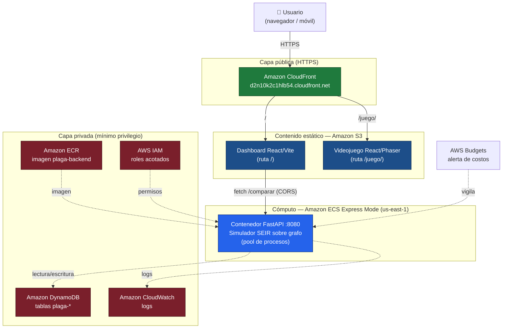

# Diagrama de arquitectura — Plaga Zombie: Manabí

Fuente del diagrama en **Mermaid**. Para exportar a imagen (PNG/SVG):
pega el bloque de abajo en <https://mermaid.live> y usa "Export".

- 🟩 **Verde** = público (CloudFront, API)
- 🟦 **Azul** = cómputo y estáticos
- 🟥 **Rojo/gris** = privado (roles, tablas, logs)

## Flujo

1. El **usuario** entra por HTTPS a **CloudFront**, que da una sola URL pública.
2. CloudFront sirve los estáticos desde **S3**: el **dashboard** en `/` y el
   **videojuego** en `/juego/`.
3. El dashboard llama directamente a la **API FastAPI en ECS** (`POST /comparar`),
   permitido por CORS. La API corre el simulador (300+ corridas no, tope 150 por
   el límite de 60 s del balanceador) y devuelve métricas, curvas p10–p90 y R0.
4. La **imagen** del contenedor vive en **ECR**; ECS la despliega.
5. **DynamoDB** (`plaga-*`) guarda datos; **CloudWatch** recoge logs; **IAM**
   da permisos mínimos; **AWS Budgets** vigila el costo.

## Qué es público y qué es privado

- **Público:** CloudFront (y, de hecho, la URL de la API de ECS).
- **Privado:** las tablas DynamoDB, los roles IAM y los logs no son accesibles
  desde internet; solo el contenedor los usa con permisos acotados.
